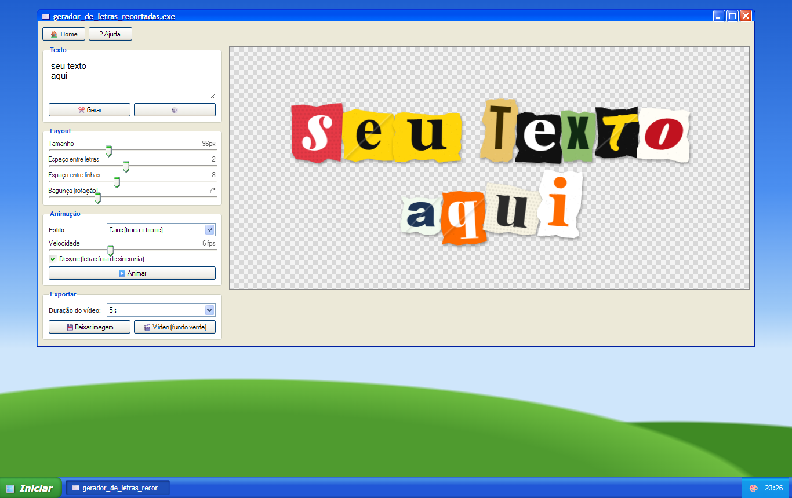
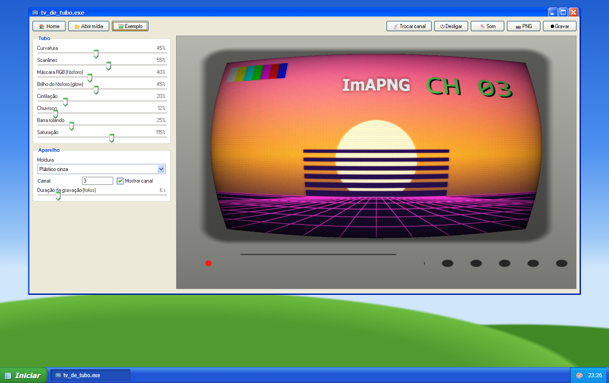
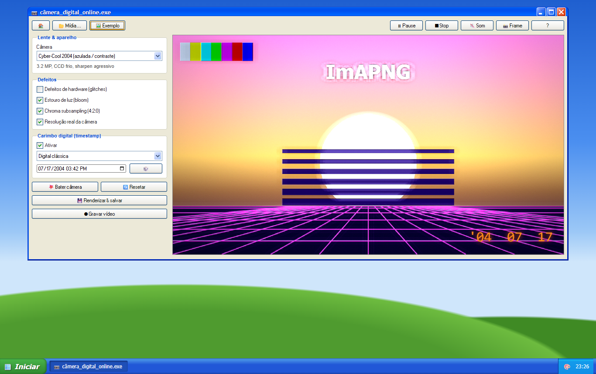
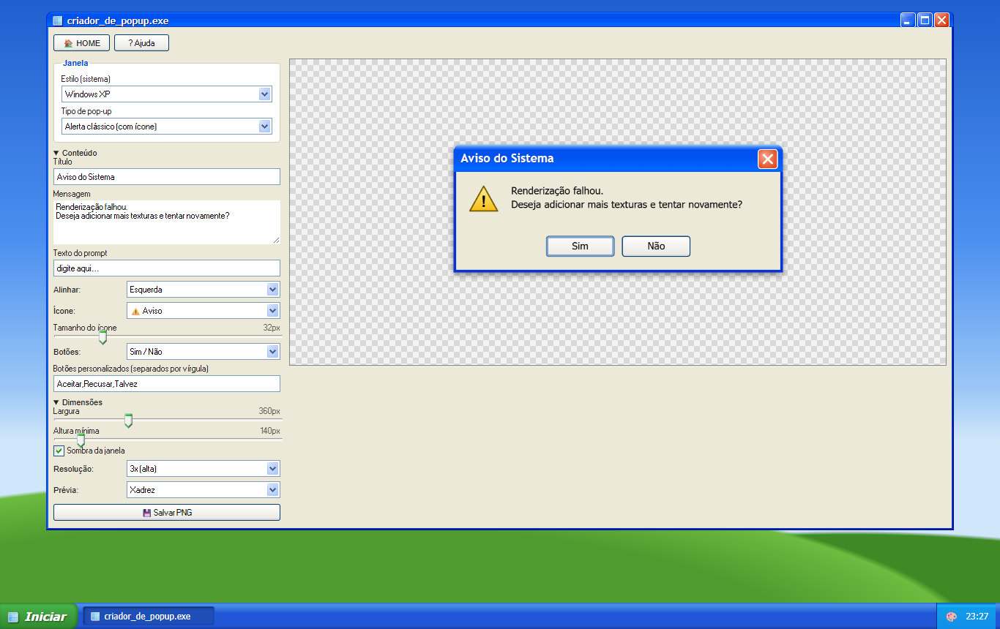
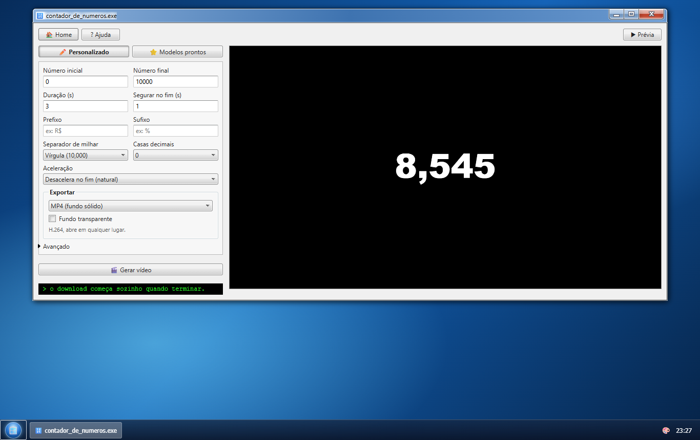

<div align="center">

# 🖼️ editools

**Ferramentas gratuitas pra quem edita vídeo, numa área de trabalho retrô.**
Remova fundos, crie botões, faça texto 3D, efeito VHS, contadores, petpet e muito mais, direto no navegador.


</div>

---

## ✨ Por que é legal

- 🔒 **Privado:** tudo roda no seu navegador. Suas imagens, vídeos e áudios não vão pra servidor nenhum.
- 🪟 **Nostálgico:** janelas que você arrasta, menu Iniciar, barra de tarefas e 3 temas (Windows 98, XP e 7 Aero).
- ⚡ **Zero instalação:** HTML, CSS e JavaScript puros. Abriu o `index.html`, funcionou.
- 📱 **Funciona no celular** também.

## 🧰 Ferramentas

| | Ferramenta | O que faz |
|:-:|---|---|
| ✂️ | **Removedor de fundo** | Tira o fundo de várias imagens de uma vez com IA (RMBG-1.4), com retoque no pincel e download em .zip |
| 🔘 | **Criador de botões** | 12 estilos prontos, texto, ícone, gradiente, borda, 3D, sombra e neon. PNG transparente até 8x e os 3 estados (normal, hover, pressionado) |
| ✉️ | **Letras recortadas** | Escreva com letras de revista recortadas. Anima, deixa arrastar cada letra e exporta PNG ou vídeo em fundo verde |
| 🧊 | **Texto 3D** | 8 materiais (cromado, holográfico, neon, toon…), fontes com acento, importa TTF e exporta PNG transparente |
| 📼 | **Modulador VHS** | Ruído, scanlines, glitch, sangramento de cor e letreiro de câmera em foto ou vídeo |
| 📺 | **TV de tubo** | Curvatura, fósforo RGB, moldura de TV, troca de canal e liga/desliga |
| 📷 | **Câmera digital** | Simula 8 câmeras antigas, com carimbo de data e o botão "bater câmera" |
| 🐟 | **Olho de peixe** | Lente fisheye anos 2000 com peephole, chroma key e texturas |
| 👾 | **Pixelador** | Pixel art com paletas (Game Boy, 8-bit, CGA…) e dithering |
| 🪟 | **Criador de pop-up** | Janelas de erro do Windows 98/XP/7 em PNG de alta resolução |
| 🫳 | **Petpet** | GIF da mãozinha fazendo carinho na sua imagem, com fundo transparente |
| 🔢 | **Contador de números** | Vídeo de número subindo em MP4, WEBM transparente ou sequência PNG |
| 📀 | **DVDficar** | Sua logo quicando igual descanso de tela do DVD |
| 🎙️ | **Áudio analógico** | Rádio AM, fita cassete, vinil, telefone, walkie-talkie… com osciloscópio e exportação em MP3 |
| 🌈 | **Gradientes animados** | Gradientes em loop perfeito, exporta MP4 |
| 📜 | **Texturas de papel** | Papel animado em stop motion pra usar de fundo ou overlay |
| ⚙️ | **Scripts para After Effects** | 9 scripts: safe zone, importar SRT, logo DVD, expressões em massa, organizador de projeto e mais |
| 🔗 | **Links** | Página de links com player de música, conversor MP4 → MP3, bloco de notas e um cmd |

## 📸 Telas

<table>
  <tr>
    <td><p align="center">Criador de botões</p></td>
    <td><p align="center">Modulador VHS</p></td>
  </tr>
  <tr>
    <td><p align="center">Texto 3D</p></td>
    <td><p align="center">Letras recortadas</p></td>
  </tr>
  <tr>
    <td><p align="center">TV de tubo</p></td>
    <td><p align="center">Câmera digital</p></td>
  </tr>
  <tr>
    <td><p align="center">Criador de pop-up</p></td>
    <td><p align="center">Contador de números (tema 7)</p></td>
  </tr>
</table>

## 🚀 Como usar

```bash
git clone https://github.com/kauanfelipeppdev/editools.git
cd editools
```

Depois é só abrir o `index.html` no navegador. Se preferir rodar num servidor local:

```bash
npx serve .
```

**Pra colocar no ar:** em *Settings › Pages* do repositório, escolha a branch `main` e a pasta raiz. Também funciona em Netlify, Vercel, Neocities ou qualquer hospedagem de site estático.

> 💡 Gravar e exportar vídeo funciona melhor no **Chrome** ou no **Edge**.

## 🗂️ Estrutura

```
├── index.html            área de trabalho
├── *.html                uma página por ferramenta
├── assets/
│   ├── os.js / os.css    temas, janelas, barra de tarefas e utilitários
│   ├── glfx.js           shaders WebGL sobre imagem e vídeo
│   ├── media-tool.js     abrir mídia, salvar PNG e gravar vídeo
│   ├── encode.js         MP4 quadro a quadro (WebCodecs)
│   └── mp3.js            decodifica e codifica MP3
├── scripts/              scripts .jsx do After Effects (+ .zip)
└── docs/                 imagens deste README
```

Pra adicionar uma ferramenta nova, crie o `.html` e coloque ela na lista `TOOLS` em `assets/os.js`: ela aparece sozinha na área de trabalho e no menu Iniciar.

## 🙏 Créditos

Feito com [98.css](https://github.com/jdan/98.css), [XP.css](https://github.com/botoxparty/XP.css), [7.css](https://github.com/khang-nd/7.css), [three.js](https://threejs.org), [Transformers.js](https://github.com/huggingface/transformers.js) + [RMBG-1.4](https://huggingface.co/briaai/RMBG-1.4), [gifenc](https://github.com/mattdesl/gifenc), [lamejs](https://github.com/zhuker/lamejs), [mp4-muxer](https://github.com/Vanilagy/mp4-muxer), [webm-muxer](https://github.com/Vanilagy/webm-muxer) e [JSZip](https://stuk.github.io/jszip/).

Inspirado nas ferramentas do [nando.mp4](https://www.nandomp4.com/), no [petpet generator](https://benisland.neocities.org/petpet/) e no [Number Counter Maker](https://number-counter-maker.vercel.app/).

<div align="center"><sub>feito por <a href="https://github.com/kauanfelipeppdev">@kauanfelipeppdev</a> 🖤</sub></div>
