<div align="center">

# 🖼️ EdiTools

**Ferramentas gratuitas pra quem edita vídeo, numa área de trabalho retrô.**
Legenda automática com IA, removedor de fundo, conversa animada, terminal, thumbnail, texto 3D, VHS, petpet e muito mais, direto no navegador.


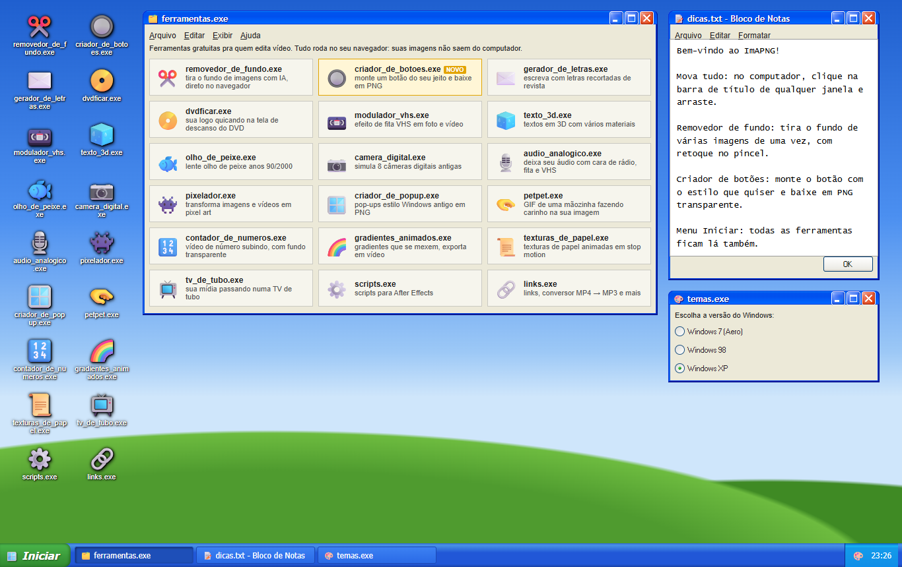

</div>

---

## ✨ Por que é legal

- 🔒 **Privado:** tudo roda no seu navegador, até as IAs. Seus vídeos, imagens e áudios não vão pra servidor nenhum.
- 🪟 **Nostálgico:** janelas que você arrasta, menu Iniciar, barra de tarefas, 3 temas (Windows 98, XP e 7 Aero), papel de parede e proteção de tela.
- 🔗 **Tudo conversa:** baixou algo? Clique em **➡️ Enviar para…** e abra o resultado em outra ferramenta. Ou solte um arquivo em cima de um ícone da área de trabalho.
- 📂 **Meus arquivos:** tudo que você exporta fica guardado no navegador pra baixar de novo.
- 📲 **Vira aplicativo:** dá pra instalar (Menu Iniciar › Instalar) e usar até sem internet.
- 🌐 **Português e inglês**, e funciona no celular.
- ⚡ **Zero instalação:** HTML, CSS e JavaScript puros.

## 🧰 Ferramentas

### 🎬 Vídeo
| | Ferramenta | O que faz |
|:-:|---|---|
| 💬 | **Legenda automática** | A IA Whisper transcreve o vídeo palavra por palavra. 10 estilos prontos (destaque amarelo, karaokê, caixinha na palavra, neon…), tudo personalizável. Exporta SRT, VTT, legenda transparente ou o vídeo já legendado |
| 📱 | **Conversa animada** | Vídeo de chat mensagem por mensagem, com "digitando…", ✓✓ de lida, imagens, grupos e som de notificação. 7 visuais genéricos, incluindo um **chat com IA** em que a resposta vai sendo escrita aos poucos |
| 🖱️ | **Gravador de scroll** | Transforma o print da página inteira num vídeo rolando, com paradas, moldura de navegador, celular ou notebook |
| ⌨️ | **Terminal** | Janela de terminal bonita (14 temas, 10 fontes, macOS/Windows/Linux) em PNG, SVG, área de transferência ou vídeo com a digitação acontecendo |
| 📼 | **Modulador VHS** | Ruído, scanlines, glitch, sangramento de cor e letreiro de câmera em foto ou vídeo |
| 📺 | **TV de tubo** | Curvatura, fósforo RGB, moldura de TV, troca de canal e liga/desliga |
| 📷 | **Câmera digital** | Simula 8 câmeras antigas, com carimbo de data e o botão "bater câmera" |
| 🐟 | **Olho de peixe** | Lente fisheye anos 2000 com peephole, chroma key e texturas |
| 📀 | **DVDficar** | Sua logo quicando igual descanso de tela do DVD |
| 🌈 | **Gradientes animados** | Gradientes em loop perfeito, exporta MP4 |
| 📜 | **Texturas de papel** | Papel animado em stop motion pra usar de fundo ou overlay |

### 🖼️ Imagem
| | Ferramenta | O que faz |
|:-:|---|---|
| ✂️ | **Removedor de fundo** | Tira o fundo de várias imagens de uma vez com IA (RMBG-1.4), com retoque no pincel e download em .zip |
| 🖼️ | **Thumbnail** | Editor com camadas (imagem, texto, emoji, seta, círculo, caixa), contorno de figurinha, 6 modelos e a aba **Ver no feed**. JPG ajustado pra caber em 2 MB |
| 💻 | **Mockups** | Print ou vídeo dentro de celular, tablet, notebook, monitor, navegador, polaroid, TV antiga ou relógio |
| 🔘 | **Criador de botões** | 12 estilos prontos, PNG transparente até 8x e os 3 estados (normal, hover, pressionado) |
| 🧊 | **Texto 3D** | 8 materiais (cromado, holográfico, neon, toon…), fontes com acento, importa TTF |
| ✉️ | **Letras recortadas** | Letras de revista recortadas, animadas, em PNG ou vídeo em fundo verde |
| 👾 | **Pixelador** | Pixel art com paletas (Game Boy, 8-bit, CGA…) e dithering |
| 🪟 | **Criador de pop-up** | Janelas de erro do Windows 98/XP/7 em PNG de alta resolução |
| 🫳 | **Petpet** | GIF da mãozinha fazendo carinho na sua imagem |

### 🔤 Texto e animação
| | Ferramenta | O que faz |
|:-:|---|---|
| 🔤 | **Animação de texto** | 15 efeitos: máquina de escrever, pop, quique, onda, glitch, embaralhar, desfoque, neon, arco-íris, explosão… |
| ⏳ | **Barra de progresso** | 9 estilos (blocos retrô, janela de cópia, anel, bateria, pixel…) com "travadinhas" de carregamento de verdade |
| 🔔 | **Botão de inscreva-se** | No visual do YouTube: o cursor clica em Inscrever-se, ativa o sininho em "Todas" e dá gostei. Cole o link do canal pra puxar foto, nome e inscritos |
| ⏱️ | **Cronômetro** | Regressiva ou cronômetro em 6 estilos (flip, display digital, LED, anel…), com modo ao vivo em tela cheia |
| 🔢 | **Contador de números** | Número subindo em MP4, WEBM transparente ou sequência PNG |

### 🎙️ Áudio e outros
| | Ferramenta | O que faz |
|:-:|---|---|
| 🎧 | **Audiograma** | Áudio vira vídeo com onda animada (barras, espelhado, onda, circular, pontos, linha do tempo), com o som junto |
| 🎙️ | **Áudio analógico** | Rádio AM, fita cassete, vinil, telefone, walkie-talkie… exporta MP3 |
| ⚙️ | **Scripts para After Effects** | 9 scripts: safe zone, importar SRT, logo DVD, expressões em massa e mais |
| 📂 | **Meus arquivos** | Histórico do que você exportou, com "Enviar para…" |
| 🔗 | **Links** | Página de links com player de música, conversor MP4 → MP3, bloco de notas e um cmd |

Na área de trabalho e no menu Iniciar também tem atalhos pros sites do **Photoshop**, **After Effects**, **Premiere Pro** e **Illustrator**.

> Tudo que tem fundo tem a opção de **fundo transparente**. Quase tudo que gera vídeo exporta em **MP4**, **WEBM com transparência** ou **sequência PNG**, quadro a quadro (pode trocar de aba enquanto gera).

## 📸 Telas

<table>
  <tr>
    <td>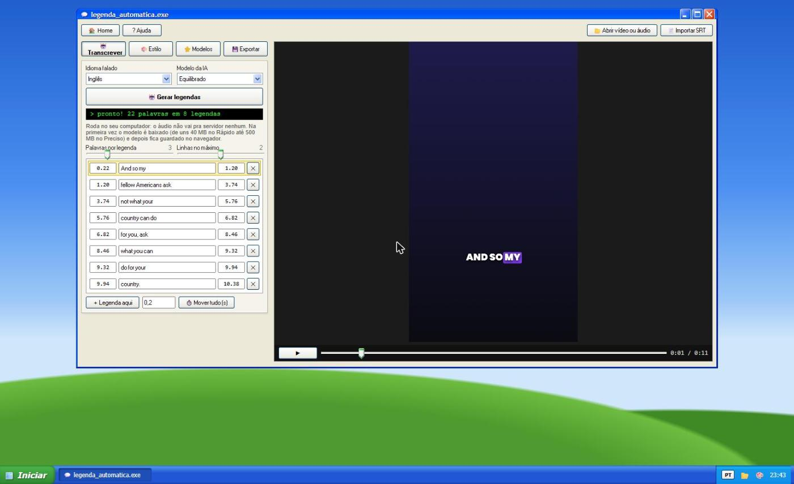<p align="center">Legenda automática</p></td>
    <td>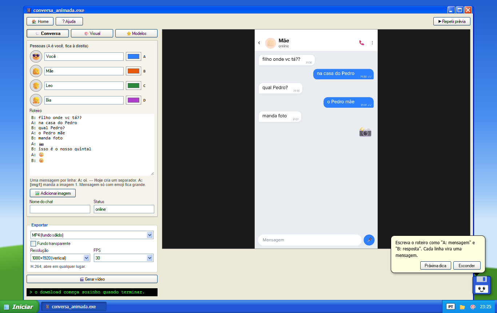<p align="center">Conversa animada</p></td>
  </tr>
  <tr>
    <td>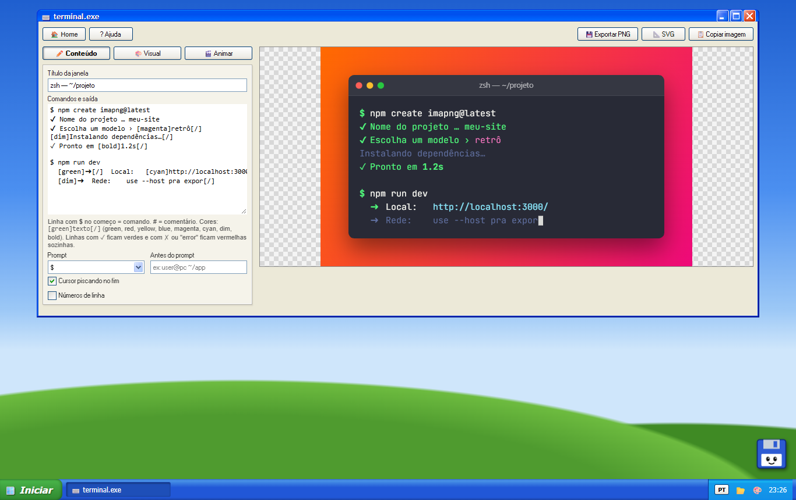<p align="center">Terminal</p></td>
    <td>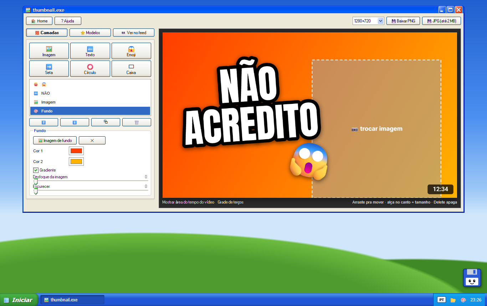<p align="center">Thumbnail</p></td>
  </tr>
  <tr>
    <td>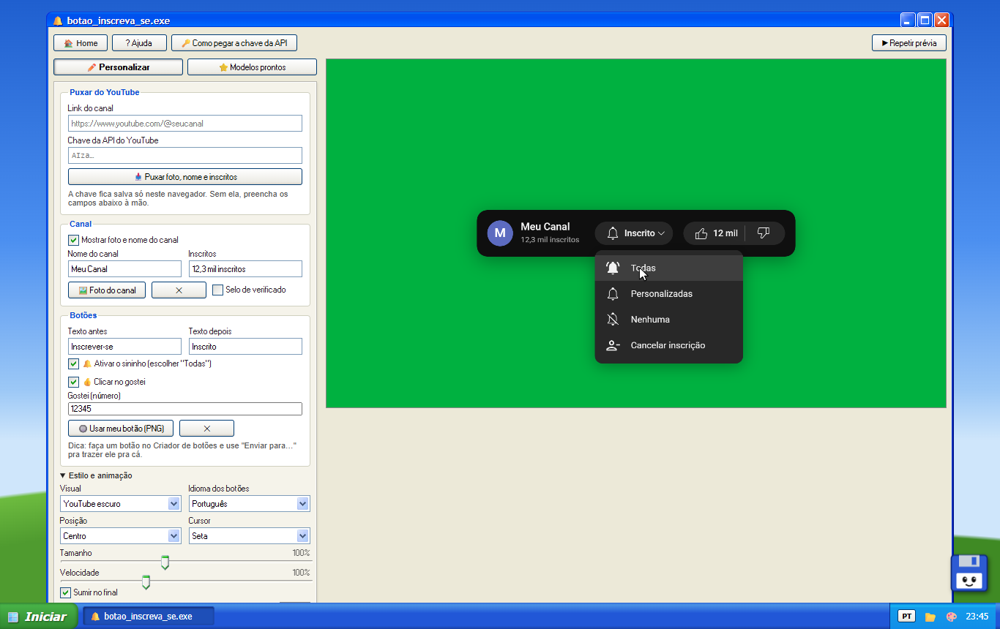<p align="center">Botão de inscreva-se</p></td>
    <td>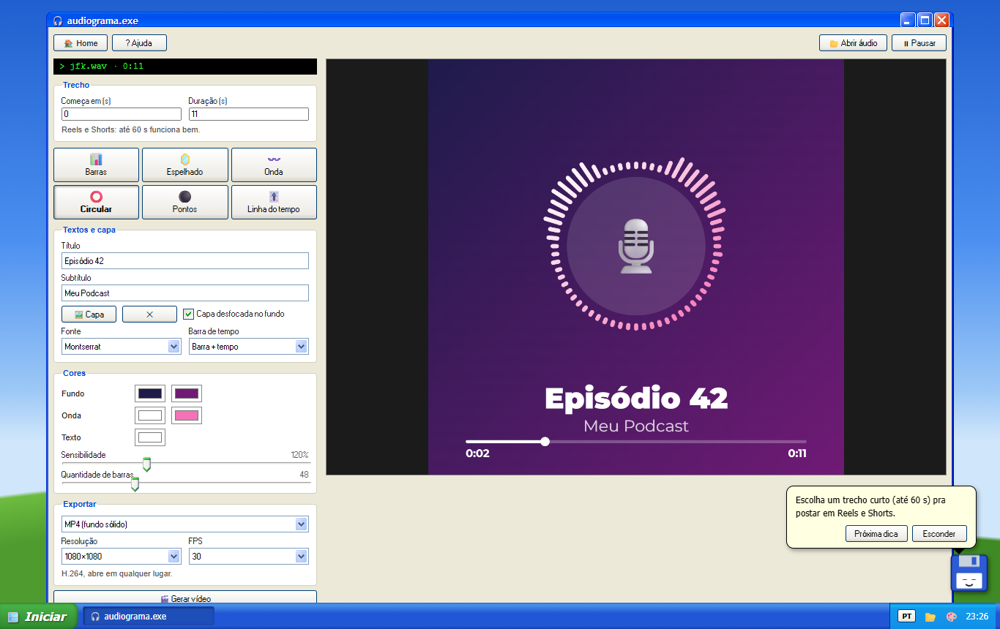<p align="center">Audiograma</p></td>
  </tr>
  <tr>
    <td>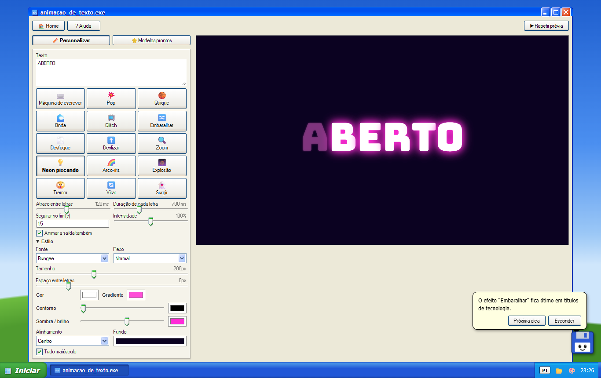<p align="center">Animação de texto</p></td>
    <td>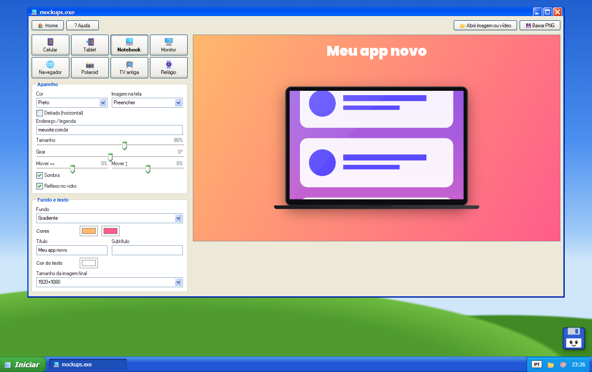<p align="center">Mockups</p></td>
  </tr>
  <tr>
    <td>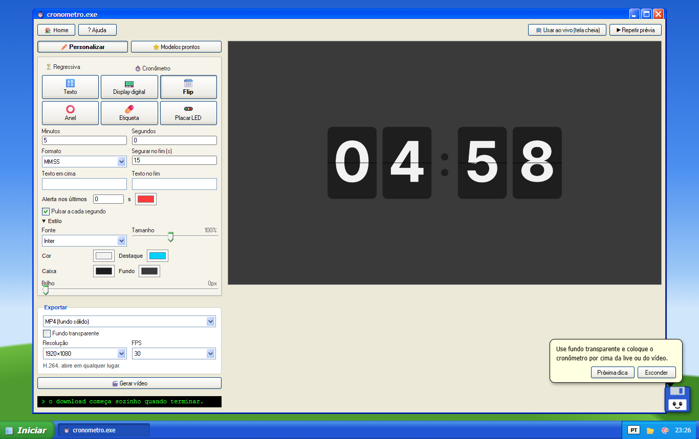<p align="center">Cronômetro</p></td>
    <td>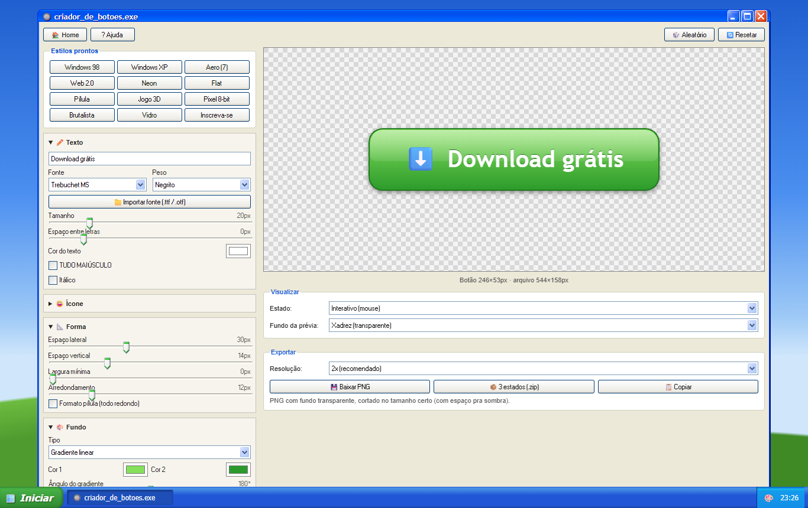<p align="center">Criador de botões</p></td>
  </tr>
  <tr>
    <td>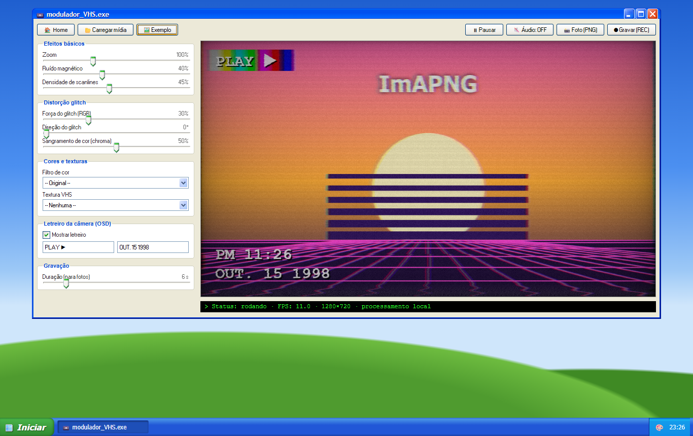<p align="center">Modulador VHS</p></td>
    <td>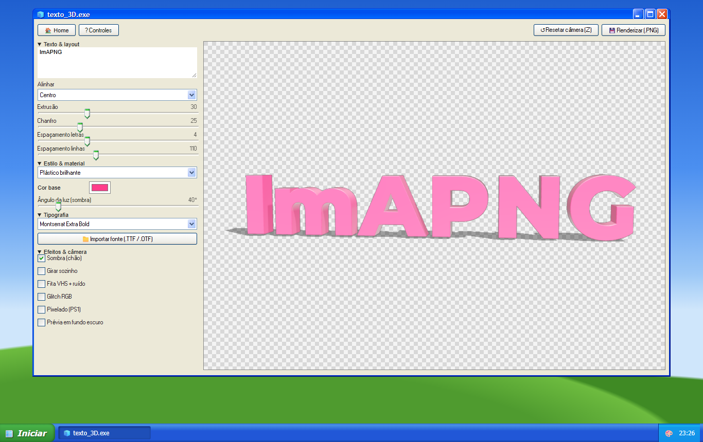<p align="center">Texto 3D</p></td>
  </tr>
</table>

## 🚀 Como usar

```bash
git clone https://github.com/kauanfelipeppdev/editools.git
cd editools
npx serve .
```

Abrindo o `index.html` direto também funciona, mas a instalação como aplicativo e o modo offline só ligam quando o site é servido por `http(s)`.

**Pra colocar no ar:** em *Settings › Pages* do repositório, escolha a branch `main` e a pasta raiz. Também funciona em Netlify, Vercel, Neocities ou qualquer hospedagem de site estático.

> 💡 Gravar e exportar vídeo funciona melhor no **Chrome** ou no **Edge**. As IAs baixam o modelo na primeira vez e depois ficam guardadas no navegador.

### 🔑 Puxar dados do canal do YouTube

O botão de inscreva-se usa a **YouTube Data API v3**, que pede uma chave grátis: crie um projeto no [Google Cloud Console](https://console.cloud.google.com/), ative a *YouTube Data API v3* e gere uma *chave de API*. A chave fica salva só no navegador de quem usa.

## 🗂️ Estrutura

```
├── index.html             área de trabalho
├── *.html                 uma página por ferramenta
├── manifest.webmanifest   dados do aplicativo instalável
├── sw.js                  service worker (modo offline)
├── assets/
│   ├── os.js / os.css     temas, janelas, barra de tarefas, Meus arquivos, Enviar para,
│   │                      papel de parede, proteção de tela e o Disquinho
│   ├── export.js          exportação comum: MP4/WEBM/PNG quadro a quadro, com áudio
│   ├── i18n.js            versão em inglês
│   ├── glfx.js            shaders WebGL sobre imagem e vídeo
│   ├── media-tool.js      abrir mídia, salvar PNG e gravar vídeo
│   ├── encode.js          MP4 quadro a quadro (WebCodecs)
│   └── mp3.js             decodifica e codifica MP3
├── scripts/               scripts .jsx do After Effects (+ .zip)
└── docs/                  imagens deste README
```

Pra adicionar uma ferramenta nova, crie o `.html` e coloque ela na lista `TOOLS` em `assets/os.js`. Se ela abre arquivos, preencha o `accept` (ex.: `'^image/'`) que ela aparece sozinha no "Enviar para…".

## 🙏 Créditos

Feito com [98.css](https://github.com/jdan/98.css), [XP.css](https://github.com/botoxparty/XP.css), [7.css](https://github.com/khang-nd/7.css), [three.js](https://threejs.org), [Transformers.js](https://github.com/huggingface/transformers.js) com [RMBG-1.4](https://huggingface.co/briaai/RMBG-1.4) e [Whisper](https://huggingface.co/onnx-community/whisper-base_timestamped), [gifenc](https://github.com/mattdesl/gifenc), [lamejs](https://github.com/zhuker/lamejs), [mp4-muxer](https://github.com/Vanilagy/mp4-muxer), [webm-muxer](https://github.com/Vanilagy/webm-muxer), [JSZip](https://stuk.github.io/jszip/) e ícones do [Material Icons](https://fonts.google.com/icons).

Inspirado nas ferramentas do [nando.mp4](https://www.nandomp4.com/), no [petpet generator](https://benisland.neocities.org/petpet/), no [Number Counter Maker](https://number-counter-maker.vercel.app/) e no [Codeshot](https://codeshot.io/terminal).

Photoshop, After Effects, Premiere Pro, Illustrator e YouTube são marcas das respectivas empresas. Os atalhos só levam pros sites oficiais, e o projeto não tem ligação com elas.

<div align="center"><sub>feito por <a href="https://github.com/kauanfelipeppdev">@kauanfelipeppdev</a> 🖤</sub></div>
